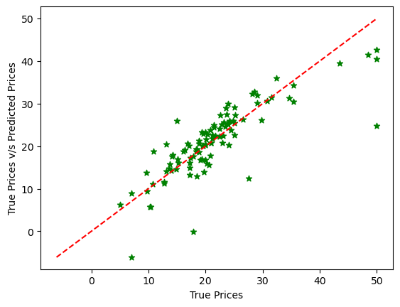

# ML — Boston Housing Price Prediction

  

An educational machine learning project that estimates historical Boston-area median home values using **multiple linear regression**. It includes an exploratory Jupyter notebook, a Boston Housing CSV dataset, a saved model, and an interactive Streamlit application with 13 feature sliders.

## Project image



*Actual output from the committed notebook: test-set values compared with model predictions. The dashed diagonal represents perfect predictions. Values are in thousands of historical US dollars. This is a model visualization, not a screenshot of the app.*

## What the project does

- Explores dataset dimensions, types, missing values, and descriptive statistics.
- Splits the data into training and test sets with a fixed random seed.
- Fits scikit-learn's `LinearRegression` estimator using all 13 predictors.
- Evaluates predictions with mean squared error and R².
- Visualizes actual versus predicted values and residual errors.
- Loads a serialized estimator in Streamlit and displays an estimate after the user clicks **submit**.

## Dataset and features

`BostonHousing.csv` contains **506 rows**, **13 predictors**, and the target **MEDV**. The notebook's saved inspection reports no missing values.

| Feature | Description |
| --- | --- |
| CRIM | Per-capita crime rate by town |
| ZN | Proportion of residential land zoned for lots over 25,000 square feet |
| INDUS | Proportion of non-retail business acres per town |
| CHAS | Charles River indicator: 1 if the tract borders the river, otherwise 0 |
| NOX | Nitric oxide concentration, in parts per 10 million |
| RM | Average number of rooms per dwelling |
| AGE | Proportion of owner-occupied units built before 1940 |
| DIS | Weighted distance to five Boston employment centers |
| RAD | Index of accessibility to radial highways |
| TAX | Full-value property-tax rate per $10,000 |
| PTRATIO | Pupil–teacher ratio by town |
| B | Historical race-derived variable: 1000 × (Bk − 0.63)²; Bk is the proportion of Black residents by town |
| LSTAT | Percentage classified as lower socioeconomic status in the original dataset terminology |
| MEDV | Target: median value of owner-occupied homes, in $1,000s |

The feature order above matches the app and training notebook. The CSV uses lowercase column names; the app constructs uppercase labels and supplies the same positional order to the estimator.

## Model and recorded results

The notebook uses an **80/20 train/test split**, `random_state=42`, with **404 training rows** and **102 test rows**. It fits ordinary least squares without a scaling pipeline or hyperparameter search.

| Metric | Recorded notebook result |
| --- | ---: |
| Test mean squared error | 24.2911 (thousand dollars)² |
| Test R² | 0.66876 |

These are the notebook's saved results, not a newly executed benchmark or cross-validation estimate. The app multiplies the model output by 1,000 to format a dollar amount. These historical values do not represent current market prices.

## Run locally

Use Python 3.11 or later, starting from the repository root:

```bash
git clone https://github.com/vams2krish/ML-Boston-Housing-Price-Prediction.git
cd ML-Boston-Housing-Price-Prediction
python -m venv .venv
```

Activate the environment:

```powershell
# Windows PowerShell
.venv\Scripts\Activate.ps1
```

```bash
# macOS / Linux
source .venv/bin/activate
```

Install and launch:

```bash
python -m pip install -r requirements.txt
python -m streamlit run app.py
```

Open the local URL printed by Streamlit, adjust the feature sliders, and click **submit** to display the predicted value. Run the command from the repository root so the relative artifact path resolves.

### Explore or retrain in Jupyter

```bash
python -m pip install notebook
python -m notebook
```

Open `House Prediction - Linear Regression.ipynb` and execute cells in order. Its CSV path is relative to the repository root. The notebook writes the fitted estimator to `artifacts/predicted_price.pkl`.

The original final cell also writes the estimator into files named `target_test.pkl`, `target_pred.pkl`, and `residuals.pkl`; those names do **not** indicate saved arrays. Only `predicted_price.pkl` is used by the app.

## Repository structure

```text
.
├── app.py                                  # Streamlit prediction interface
├── BostonHousing.csv                       # Dataset: predictors and MEDV target
├── House Prediction - Linear Regression.ipynb
├── artifacts/
│   └── predicted_price.pkl                  # Serialized fitted estimator
├── docs/images/actual-vs-predicted.png      # Notebook visualization
├── requirements.txt                        # Python dependencies
├── setup.py                                # Local package metadata
├── src/                                    # Local package directory
├── Procfile                                # Legacy Heroku launch command
└── setup.sh                                # Legacy Streamlit deployment setup
```

## Limitations and responsible use

This is a historical learning exercise. The dataset includes a race-derived predictor and socioeconomic terminology that encode problematic assumptions. Retaining these variables documents the original implementation; it does not establish that they are appropriate for real housing decisions.

The model has one fixed test split, no cross-validation, no uncertainty intervals, and no demonstrated performance on current housing data. Linear regression can produce unrealistic values for unusual inputs, and some slider bounds extend beyond the observed training range. Use it for studying regression and app integration, not property appraisal, lending, or other consequential decisions.

Dependencies are currently unpinned. Pickled scikit-learn models can be incompatible across versions; if loading fails, retrain with the installed environment. Only load pickle files from a trusted source.

## Technology

Python · pandas · NumPy · scikit-learn · Matplotlib · Jupyter Notebook · Streamlit

## Author and licensing

**Vamshi Krishna Adam** — [GitHub](https://github.com/vams2krish)

The package metadata declares MIT, but this repository does not currently include a standalone LICENSE file. Dataset redistribution terms should be checked separately before reuse.
